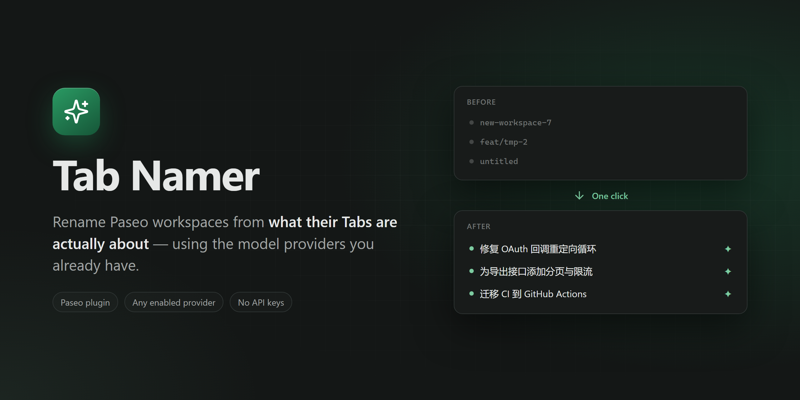
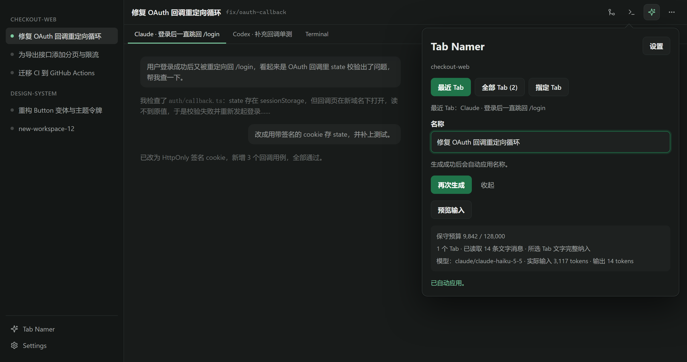
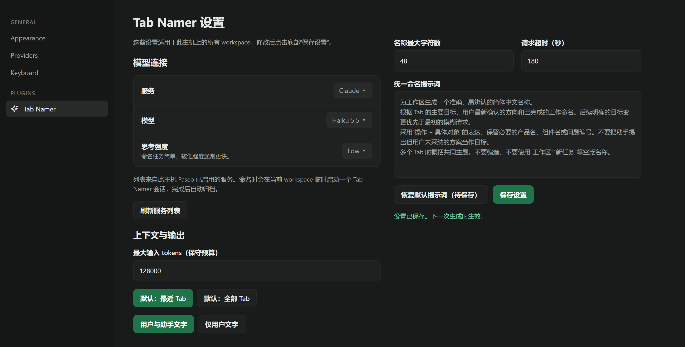
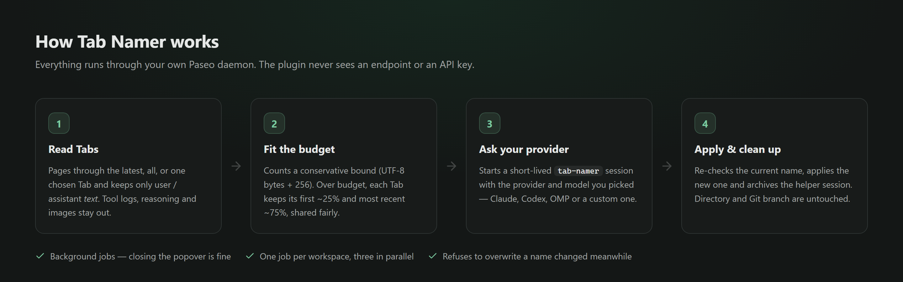

<p align="center">
  
</p>

<p align="center">
  <a href="https://github.com/stv1024/paseo-tab-namer/releases"></a>
  
  
  
  <a href="LICENSE"></a>
</p>

<p align="center">
  <b>English</b> · <a href="README.zh-CN.md">简体中文</a>
</p>

---

**Tab Namer** is a [Paseo](https://github.com/getpaseo/paseo) plugin that gives your workspaces names that actually mean something. It reads the conversation in a workspace's Tabs, asks a model from one of the providers you've already enabled in Paseo, and applies a short, specific name, such as `修复 OAuth 回调重定向循环` instead of `new-workspace-7`.

- ✨ **One click**: a Sparkles button in every workspace header. The new name is applied as soon as it's generated.
- 🔌 **Uses your existing providers**: Claude, Codex, OMP or any custom provider enabled in Paseo. The plugin has no endpoint, API key or extra dependency of its own.
- 🎯 **You choose the context**: name from the most recent Tab, all Tabs, or one Tab you pick.
- 📏 **Fits long Tabs into a budget**: a conservative input budget keeps the beginning and the most recent part of each Tab and makes no extra summarization calls.
- 🔒 **Text only**: only user and assistant text is sent. Tool logs, reasoning and raw images stay out.
- 🧹 **Cleans up after itself**: the helper session is archived as soon as it replies. The directory and Git branch are never touched.

> [!NOTE]
> The plugin UI and the default naming prompt are in **Simplified Chinese**. Edit the prompt in settings to generate names in another language.

## Screenshots

<p align="center">
  
  <br /><sub>The header popover after a generation, with <b>More</b> expanded to show budget and usage.</sub>
</p>

<p align="center">
  
  <br /><sub>Settings apply to every workspace on the host: provider, model, thinking level, budget and prompt.</sub>
</p>

> Images are illustrative mockups built from the plugin's real UI and Paseo's dark theme. Their sources are in [`docs/media-src`](docs/media-src).

## Installation

Requires **Paseo 0.11.2 or newer**.

```sh
paseo plugin install git:stv1024/paseo-tab-namer
```

Pin a version with `--ref <tag-or-commit>`. Update later with `paseo plugin update tab-namer`.

On first use, open **Settings → Tab Namer**, pick a **provider** and a **model**, then click **保存设置** (Save settings).

## Usage

1. Click the **✨ Tab Namer** button in a workspace header.
2. Pick the scope: **最近 Tab** (most recent), **全部 Tab** (all) or **指定 Tab** (a specific Tab).
3. Click **生成名称** (Generate). The name is applied right away. **再次生成** (Regenerate) gives you another one.
4. To fine-tune by hand, edit the field and click **应用手动修改** (Apply manual edit).

Under **更多** (More), **预览输入** (Preview input) shows exactly what will be sent and how much of the budget it uses, without calling the model.

Other entry points:

| Where                 | What                                                                                     |
| --------------------- | ---------------------------------------------------------------------------------------- |
| Command center        | `Tab Namer：选择 workspace 重命名` (searchable list of every workspace), `Tab Namer：重命名当前 workspace`, `Tab Namer：根据当前 Tab`, `Tab Namer 设置` |

## How it works

<p align="center">
  
</p>

Paseo exposes models to plugins only through agents. When you click Generate, the plugin starts a temporary session titled **Tab Namer** (tagged `tab-namer`) in the current workspace and sends the prompt and the selected Tab text as one message. It reads the reply and archives the session right away. Tagged sessions are never read back as Tabs. All authentication stays in Paseo's provider configuration.

Generation runs as a background job that the UI polls, so you can close the popover. Each workspace runs one job at a time, with at most three jobs in parallel. Before writing, the plugin re-reads the current name and refuses to overwrite one that changed in the meantime.

## Settings

| Setting                   | Default                         | Notes                                                   |
| ------------------------- | ------------------------------- | ------------------------------------------------------- |
| Provider & model          | _not set_                       | Listed from the providers enabled on this Paseo host     |
| Thinking level            | Model default                   | Lower is usually faster; naming is a simple task         |
| Max input budget          | 128,000                         | Range 2,048–256,000; conservative upper bound            |
| Default scope             | Most recent Tab                 | Or all Tabs                                              |
| Content                   | User + assistant text           | Or user text only                                        |
| Max name length           | 48 characters                   | 8–120                                                    |
| Request timeout           | 180 s                           | 15–600                                                   |
| Naming prompt             | Built-in Chinese prompt         | Shared by all workspaces; can be reset to the default    |

<details>
<summary><b>About the input budget</b></summary>

Tokenizers differ between models, so the budget counts **UTF-8 bytes + 256** for the system prompt and the selected messages. This is usually well above the real token count: 128,000 typically holds a few tens of thousands of real tokens. When the provider reports usage, the UI shows the real figures. Make sure the model's context window can hold the budget you set.

Short Tabs are included in full. When the total goes over budget, each Tab keeps roughly its first 25% and its most recent 75%, and the budget is split fairly across Tabs (short Tabs give back what they don't use). Very long Tabs are read page by page, with a page limit. Up to 100 Tabs per run. The preview always says whether anything was cut.

Providers such as Claude Code and Codex add their own system prompt and tool definitions, so billed input tokens are higher than the naming content itself. The prompt tells the model not to use tools. If it asks for tool permission anyway, the job stops with an error.

</details>

## Privacy

- The text of the selected Tabs is sent to the provider **you** picked, and nowhere else.
- Preview never calls a model and never renames anything.
- The plugin stores no credentials. Settings live in Paseo host settings.
- Finished job results are kept in memory for about ten minutes, then dropped.

## Limitations

- Paseo doesn't let plugins add items to the native workspace context menu or rename dialog, so Tab Namer adds a header button and command-center entries instead. It does not use the sidebar, so it takes no space in the mobile workspace list.
- Names can only be based on history Paseo still has. Anything the host already discarded can't be recovered.
- Paseo has no atomic compare-and-set for names, so a change made in the instant between the check and the write can still be overwritten.

## Development

```sh
npm ci
npm run typecheck
npm test                      # node:test suite under server/

# Name the workspace for the current directory against your local Paseo,
# without renaming it
npm run test:smoke -- <provider>/<model>

paseo plugin install .        # install from a local checkout
paseo plugin reload tab-namer # after changes
```

When Paseo installs a plugin from Git, it bundles the source with esbuild and **does not run `npm install`**. Runtime code may only import what Paseo provides: `@getpaseo/plugin`, `react`, `react-native`, `zod` and Node built-ins. Everything in `devDependencies` is for type-checking, tests and scripts only.

```
index.client.tsx   UI entry: header button, screens, command center
index.server.ts    RPC handlers and background jobs
client/            rename popover/screen, settings screen, shared UI
server/            Tab reading, budgeting, model session, naming logic (+ tests)
shared/            RPC contracts and settings schema
docs/media-src/    HTML sources for README images (node docs/media-src/render.mjs)
```

### Release

Releases go to npm as `paseo-tab-namer` through
[`.github/workflows/release.yml`](.github/workflows/release.yml), with npm Trusted
Publishing (no npm token). Bump `version` in `package.json`, add a `CHANGELOG.md`
section, then commit, tag and push:

```sh
npm run typecheck && npm test && npm run pack:npm   # check the packed file list
git push origin main
git tag -a v0.1.0 -m "Tab Namer 0.1.0" && git push origin v0.1.0
```

The tag push publishes the tarball. Then create the GitHub release from the tag.
The official registry opens a bump PR for each new npm version.

## Contributing

Issues and pull requests are welcome. Before opening a PR, run `npm run typecheck` and `npm test`. For changes that affect naming quality, include before/after examples from `npm run test:smoke`.

## License

[MIT](LICENSE) © Stephen Zhou
